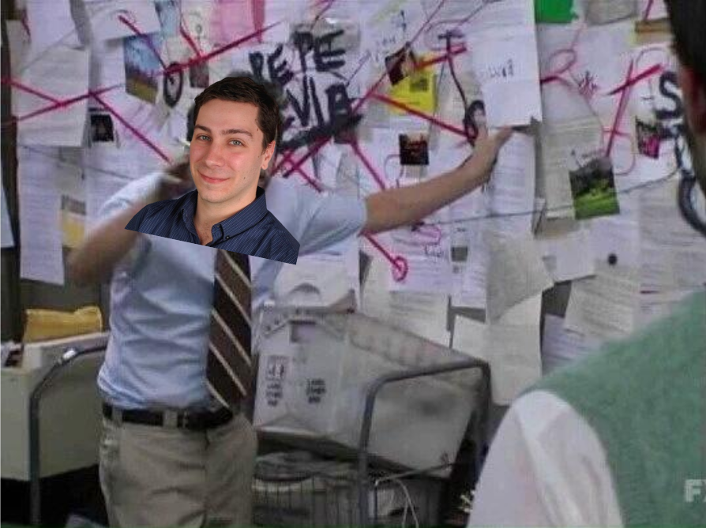

#  Breakfast Hour: Tim's Diagram

## Learning Objectives
This is a standalone Breakfast Hour activity with the following learning objectives:

1. Understand the full methodology of modeling as it pertains to what data goes where
1. Pass the correct data through Scikit-Learn model objects at the right times

## Length
The activity takes about 45 minutes.

## Prerequisites
1. Understanding of basic ML workflow
1. Familiarity with Scikit-Learn's estimators and transformers
